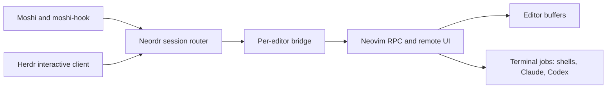

<p align="center">
  <picture>
    <source media="(prefers-color-scheme: dark)" srcset="site/assets/neordr-wordmark-dark.svg">
    
  </picture>
</p>

<p align="center"><strong>Your editor. Your terminals. Wherever you connect.</strong></p>

<p align="center">
  <a href="https://github.com/derekstavis/neordr/actions/workflows/ci.yml">CI</a> ·
  <a href="https://github.com/derekstavis/neordr/releases">Releases</a> ·
  <a href="docs/installation.md">Installation</a> ·
  <a href="https://derekstavis.github.io/neordr/">Website</a>
</p>

Neordr connects **Neovim to Moshi and Herdr**. Keep your editor, terminal jobs,
and coding agents in Neovim; connect to them from Moshi's web, desktop, or mobile
clients, or from Herdr's own terminal interface.

The full editor stays visible. Selecting a terminal focuses its Neovim buffer
in input mode, so you can move between editing files, running commands, and
chatting with an agent without maintaining a second workspace layout.

**Private preview.** Repository access is required for source and release
downloads. Interfaces are still evolving; see the compatibility limits below.

## What it does

- **Reconnect to your editor.** Discover active Neovim sessions and attach a
  remote UI while terminal jobs keep running.
- **Use Moshi Chat View.** Run Claude or Codex in managed Neovim terminals.
  Existing Moshi hooks discover the agent and stream its conversation.
- **Manage terminals remotely.** Create, name, split, reorder, focus, and close
  terminals and workspaces from the sidebar.
- **Keep your Neovim workflow.** Edit files alongside terminals; integrate your
  terminal plugin through Lua callbacks or use the built-in terminal command.
- **Connect with Herdr.** Its interactive interface renders Neovim with native
  Herdr navigation and terminal selection.
- **Use remote gestures.** Switch terminals and workspaces, focus splits, zoom,
  and detach through Herdr's default Ctrl-B shortcuts.

## Get started

Install the binary **and its Lua integration** using the
[installation guide](docs/installation.md). Release archives target Linux and
macOS on both x86-64 and AArch64. Neordr requires Neovim 0.12 or newer; the
verified Neovim version is **0.12.5**.

Install the Lua plugin through your plugin manager. For Neovim's `vim.pack`:

```lua
vim.pack.add({
  { src = 'git@github.com:derekstavis/neordr.git', version = 'main' },
})
require('neordr').setup()
```

The executable must already be on `PATH`. This example follows the development
branch; the new health checks and help documentation are not in `v0.1.0`.
For a released installation, pin the plugin and binary to the same release.
See [plugin installation](docs/installation.md#install-the-neovim-plugin) for
`lazy.nvim`, release pins, and archive-only installation. No Rust build is needed
when installing the plugin alongside a downloaded binary.

Run `:checkhealth neordr` to diagnose setup and `:help neordr` for configuration
and terminal adapters. Setup reports failures without stopping your other
Neovim configuration; it does not download executables.

Restart Neovim, run `:NeordrTerm`, and start `claude`, `codex`, or your usual
shell command. In another terminal:

```sh
neordr session list
neordr session attach default
```

Detach with **Ctrl-B, q** or Neovim's `:detach`; the editor and jobs continue
running. `:NeordrStatus` shows the session name and Neovim socket.

To connect Moshi, install its normal host service and agent hooks, then opt into
the [Herdr compatibility alias](docs/installation.md#connect-moshi). Moshi displays
Neordr sessions under **Herdr**. Start agents in newly created managed terminals
so their process environment carries the correct session identity.

## How it fits together



Neovim owns editor state, terminal processes, and rendering. The default session
groups editors: each Neovim process is one workspace, and terminal buffers become
virtual Herdr tabs and panes. Native Neovim tabs remain ordinary editor layout.
Creating a workspace launches a detached headless editor in its directory,
loading your Neovim configuration. Several workspaces can use the same directory.
Closing a workspace exits its editor and jobs, including editors opened locally;
modified file buffers must be saved first. Disconnecting a client or stopping
Neordr leaves editors running.
Moshi reads the agents' own transcripts; Neordr does not parse conversations or
run a model.

The complete Herdr API and endpoint schema is generated from an **unmodified,
pinned upstream Git submodule**. Dispatch, routing, and endpoint messages use
those types without maintaining a second schema or building Herdr's terminal
engine. Full schema coverage does not imply support for every Herdr operation.
See [contract generation](build_support/README.md) and the
[architecture notes](docs/design.md).

## Diagnostics and Moshi control mode

Run `neordr doctor` (or `neordr doctor --json`) to compare registered editors,
attached UI sizes, bridge/router health, Moshi discovery and saved hook records.
Use `--session NAME doctor` to inspect one editor or `doctor --gateway-port PORT`
for a nondefault local Moshi gateway. `:checkhealth neordr` includes the current
editor's report. These checks never start services, send input, or change agent
settings. Conversation discovery and transcript readability are distinct checks;
the doctor reports discovery and does not open chat contents.

Moshi's Herdr control mode is supported through
`herdr [--session NAME] terminal session control PANE_ID --takeover --cols 80 --rows 24`.
It focuses the requested terminal and renders the **full Neovim editor**.
`--takeover` accepts control without evicting other attached clients. All clients
still share the editor's layout, focus and size constraints. Closing a control
connection detaches only that remote UI.

## Compatibility and limits

| Area | Current behavior |
| --- | --- |
| Moshi | Discovery, Term view, Claude/Codex Chat View, terminal management, and local approval flows. Hook compatibility tested through 0.4.9, including its control-mode transport. |
| Herdr interactive UI | The default session groups editor workspaces; full editor rendering, terminal selection, creation, input, resizing, and detach. [Compatibility details](docs/herdr-interface.md). |
| Multiple clients | All clients share Neovim's focus and layout. The smallest attached UI constrains the editor size. |
| Agent status | Foreground Claude/Codex detection; activity status remains `unknown`. |
| Capture | Visible and bounded recent terminal text. Exact soft-wrap reconstruction and ANSI capture are unavailable. |
| Herdr features | Supported operations are a subset. Herdr multi-pane tab groups, plugins, and direct binary terminal control/observation are not implemented; Moshi uses the supported JSON-lines CLI adapter. |
| Platforms | macOS and Linux targets; no Windows support. Published build and test results are recorded in CI. |

Session and pane identities include the owning editor's generation. Stale
targets fail instead of silently selecting another terminal. The default Moshi
router also rejects Chat View input after a supported agent exits.

See [operating notes](docs/local-setup.md) for shortcuts, socket ownership,
terminal adapters, remote-client lifetime, and known client limitations.

## Build and contribute

```sh
git clone git@github.com:derekstavis/neordr.git
cd neordr
git submodule update --init vendor/herdr
cargo build --release --locked
```

Only the top-level Herdr submodule is needed. If you already cloned without
submodules, run `git submodule update --init vendor/herdr` before building.
Rust tooling uses the repository's pinned toolchain. Run `bash scripts/check.sh`
for the CI suite, and `bash scripts/check-moshi.sh` for optional synthetic
compatibility tests against an installed Moshi hook.

Start with [CONTRIBUTING.md](CONTRIBUTING.md) and the
[development guide](docs/development.md) for tests, architecture boundaries, and
release conventions. Third-party client binaries are supplied separately and
are not redistributed with Neordr.

Neordr is an independent project. Thanks to
[Neovim](https://neovim.io/), [Herdr](https://github.com/herdrdev/herdr), and
[Moshi](https://getmoshi.app/) for the interfaces that make it possible.
